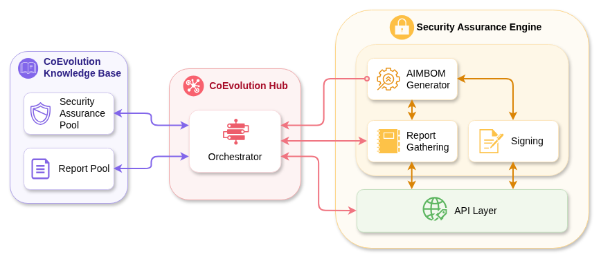
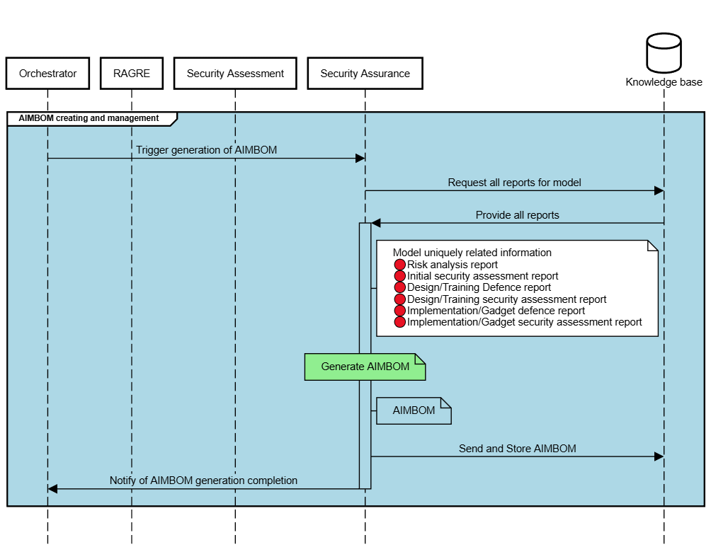

# STR Assurance Engine - Architecture

## Architecture



## AIMBOM Generation

The AIMBOM generation process is responsible for transforming validated reports into structured AIMBOMs. When a request is made for a specific AI model, STRAE retrieves all relevant reports from the Report Pool and passes them through a report validation stage, where their format, integrity, and completeness are checked. Finally, the engine consolidates these reports, using the AIMBOM Generator, to create the final security report. This process aligns the collected data with trustworthiness, fairness and ethical guidelines (as defined in T1.5 and D1.4 respectively) and ensures that security, robustness, and context-awareness findings are fully represented. The finalized AIMBOM is stored in the Security Assurance Pool and made available to the CoEvolution Hub. This ensures that every assessed AI model is accompanied by a transparent, standardized, and trustworthy record of its development, evaluation, and assurance processes.

### AIMBOM Generation Flow



### AIMBOM Deprecation Flow

When a model UUID and version already has an AIMBOM associated with it, STRAE does not generate a new AIMBOM from scratch. Instead, the generation metadata carries a `previous_aimbom` reference alongside the updated reports:

1. If `previous_aimbom` is present in the generation metadata, the generator downloads the previous AIMBOM instead of re-fetching every report.
2. Only the changed reports are downloaded and validated. The assessment report and the risk report are required, and an updated gadgets report may optionally be included. Any other report is rejected.
3. The generator copies the previous AIMBOM, increments its version, and updates the external references that point to the changed report(s). If no gadgets report is provided, the previous `Gadget List` reference is kept. The AIMBOM keeps the same serial number as the previous version, so it is identifiable as an update rather than a new artifact.
4. The updated AIMBOM is re-signed and re-validated against the CycloneDX schema before being stored.
5. If `previous_aimbom` is absent, STRAE falls back to the standard generation flow, retrieving and validating all required reports to build a new AIMBOM.

This allows the CoEvolution Hub to keep a single AIMBOM lineage per model, with each update producing a new version rather than a disconnected artifact.

## Report Signing

Every report uploaded to the CoEvolution Hub must be signed by STRAE before it reaches its final bucket. The Orchestrator first stores an uploaded report in a pending bucket (`<bucket>-pending`) and publishes a signing request on the `strae_sign_requests` Kafka topic. STRAE then signs the report and uploads the signed copy to the final bucket:

```text
report uploaded → <bucket>-pending
        ↓
Orchestrator → strae_sign_requests
        ↓
STRAE: download → sign → upload the signed copy to <bucket> with original_file_id
```

A signing request has the same format on the Kafka topic and on the `/api/sign` endpoint:

```json
{
  "model_uuid": "c83a24fc-75cc-4343-ac88-819ec36d5842",
  "version": "v1.0",
  "target_pool": "RP",
  "target_bucket": "risk-reports",
  "tags": ["assessment", "security"],
  "files": [
    {
      "_id": "6ae735e37ceea4671026265d",
      "bucket": "risk-reports-pending",
      "filename": "risk-report.json",
      "download_url": "https://aegis.coevolution-project.eu/api/v1/files/download/6ae735e37ceea4671026265d"
    }
  ]
}
```

`tags` is optional and is sent with every signed copy as a comma-separated string. The Kafka event also carries fields that signing doesn't use (`event`, `model_name`, `pool`, ...), which are ignored.

For each entry in `files`, the Report Signer (`services/report_signer.py`):

1. Downloads the file from its `download_url`. The file must be a JSON object.
2. Signs it with the configured signing key and certificate.
3. Uploads the signed copy to `target_pool` / `target_bucket` for `model_uuid` / `version`, with `original_file_id` set to the file's `_id`. Each file is uploaded in its own request.

How the outcome of each file is handled:

- **Already signed:** if the Orchestrator answers `409`, the original has already been signed (e.g. by an earlier attempt of the same request). STRAE treats the file as done, so a request can safely be sent again.
- **Rejected:** if the Orchestrator answers `400` (e.g. the original doesn't belong to the given model version or bucket), the upload is rejected.
- **Problems with one file** (missing, not a JSON object, rejected) don't stop the remaining files from being signed. They are reported together once all files have been processed.
- **Storage and signing material errors** affect every file, so processing stops at the first one.

## System Overview

STRAE is organized as a modular FastAPI application with a clear separation between HTTP entrypoints, background processing, external integrations, and domain services. The API layer accepts generation and signing requests, while a dedicated worker handles the same requests asynchronously from Kafka. Both entrypoints call the same services, which are responsible for validation, generation, signing, authentication, storage access, and orchestration with external systems.

## Core Components

- API layer: Exposes the public HTTP endpoints and coordinates request validation, business logic, and response formatting.
- AIMBOM Generator: Consolidates validated report payloads into the structured AIMBOM schema used by STRAE and ensures the final artifact follows the expected format.
- Report Gathering: Retrieves report payloads from the orchestrator/storage backend, resolves download URLs, and ensures all required source documents are available before generation.
- Signing: Applies digital signing to reports and generated AIMBOMs as needed, ensuring integrity and provenance for downstream consumers.
- Report Signer: Downloads the reports of a signing request, signs them and uploads the signed copies to their final bucket (see [Report Signing](#report-signing)).
- Worker process: Consumes AIMBOM generation and report signing requests from Kafka, decoupling asynchronous execution from the API. The Kafka-specific event handling lives in `app/consumers/`.

## Request and Processing Flow

1. A client submits a generation request through the API with generation metadata: the model UUID and version, a set of report references and, optionally, a reference to a previous AIMBOM for that model.
2. The application downloads the referenced reports (and the previous AIMBOM, if provided) from the configured storage/orchestrator source.
3. Each report is validated for schema compliance, completeness, and integrity before being used in AIMBOM generation.
4. The generator either builds a new AIMBOM from the validated reports, or, if a previous AIMBOM was supplied, produces an updated version of it that reflects the changed reports. The output is signed in both cases.
5. The resulting AIMBOM is stored in the Security Assurance Pool.

## API Endpoints

| Endpoint | Method | Description | Input | Output |
|----------|--------|-------------|-------|--------|
| `/api/status` | GET | Health check endpoint for the STRAE API | - | Health status and version information |
| `/api/sign` | POST | Downloads, signs and uploads the files of a signing request (see [Report Signing](#report-signing)) | `signing_metadata`: `model_uuid`, `version`, `target_pool`, `target_bucket`, `files` | Confirmation message, destination and the signed files (`original_file_id`, `filename`) |
| `/api/generate` | POST | Generates an AIMBOM for a given model UUID and version by aggregating reports from the configured storage backend, or produces an updated version of an existing AIMBOM when `previous_aimbom` is provided in the `generation_metadata` | `generation_metadata`: `model_uuid`, `version`, `reports` and optionally `previous_aimbom` | Confirmation message, AIMBOM identifier and version |

`/api/sign` maps errors to status codes as follows: a missing report returns `409`, an invalid file or a rejected upload returns `422`, storage and signing material errors return `503`, and any other error returns `500`.

## Kafka Worker

The Kafka worker (`python -m app.worker`) processes AIMBOM generation and report signing requests asynchronously, decoupled from the API. It runs one consumer per topic, each in its own consumer group, so the two topics are read and committed independently and a slow request on one topic never delays the other:

| Topic (setting) | Consumer group (setting) | `auto_offset_reset` (setting) | Handler |
|---|---|---|---|
| `strae` (`KAFKA_TOPIC`) | `strae` (`KAFKA_GROUP_ID`) | `latest` (`KAFKA_AUTO_OFFSET_RESET`) | `consumers/generation.py` |
| `strae_sign_requests` (`KAFKA_SIGNING_TOPIC`) | `strae-signing` (`KAFKA_SIGNING_GROUP_ID`) | `earliest` (`KAFKA_SIGNING_AUTO_OFFSET_RESET`) | `consumers/signing.py` |

`auto_offset_reset` only applies when a consumer group has no committed offset, i.e. the first time it starts, or after its offsets have expired:

- **AIMBOM generation** uses `latest`, because generation isn't safe to repeat: processing old requests again would create duplicate AIMBOM versions.
- **Report signing** uses `earliest`, because a skipped request would leave its report in the pending bucket. Repeating a signing request is safe, since already signed files are skipped. Note that changing `KAFKA_SIGNING_GROUP_ID` creates a new group, which processes everything still in the topic again.

### Commits and Error Handling

Every message is committed once it has been processed, whether it succeeded or not, so a failing message never blocks the queue. Only the message's own partition is committed. Failures are logged and not retried, like in the other CoEvolution components:

- **Invalid payloads** (not JSON, not a JSON object, missing or invalid fields) are logged and skipped.
- **Errors caused by the request** (e.g. a missing or invalid report) are logged.
- **Errors not caused by the request** (storage or connection errors, signing material errors, unexpected errors) are logged as `request dropped`, together with the full event, so the request can be sent again. For signing, the request can also be replayed by resetting the consumer group's offset (see [Deployment](deployment.md#replaying-dropped-signing-requests)).

### AIMBOM Generation Events

The generation handler branches on the event's `event` field:

- For a new AIMBOM request, the reports to use are read from the event's `reports` field.
- For an `updated-aimbom-requested` event, an existing AIMBOM should be deprecated/updated instead. The event's `changedReports` contains a reference to the previous AIMBOM (`aimbom_report`) plus the reports that changed; the handler extracts `aimbom_report` as `previous_aimbom` and passes the remaining changed reports to the generator, which produces a new, incremented version of the AIMBOM.

Processing flow:

1. Consume message from the `strae` topic
2. Validate payload (`model_uuid`, `version`)
3. Determine event type and derive `previous_aimbom`/`reports` from `reports` (new AIMBOM) or `changedReports` (AIMBOM update)
4. Retrieve the required reports (and previous AIMBOM, if any) via the orchestrator API
5. Execute AIMBOM generation or update
6. Store the generated/updated AIMBOM in the security assurance pool
7. Commit the Kafka offset

### Report Signing Events

Processing flow:

1. Consume message from the `strae_sign_requests` topic
2. Validate the payload as a signing request (`model_uuid`, `version`, `target_pool`, `target_bucket`, and `_id`, `filename`, `download_url` for each file)
3. Download, sign and upload each file (see [Report Signing](#report-signing))
4. Commit the Kafka offset

## Logging

Each layer (storage clients, services) logs a single line when an error occurs. The full traceback is logged only once, where the error is finally handled: in the API route or the Kafka handler. Since every error is raised from the one underneath it, that traceback shows the whole chain, e.g. from the HTTP connection error up to the signing error.
