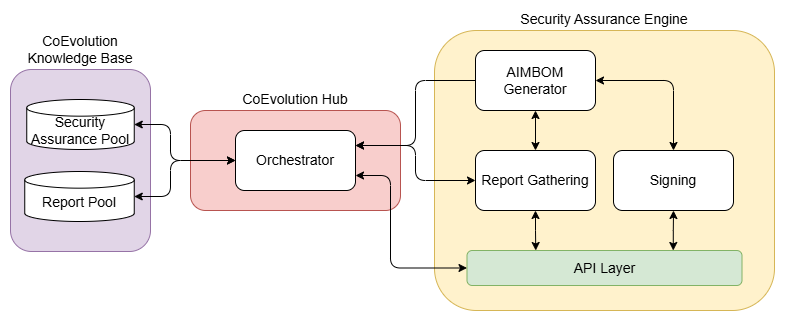
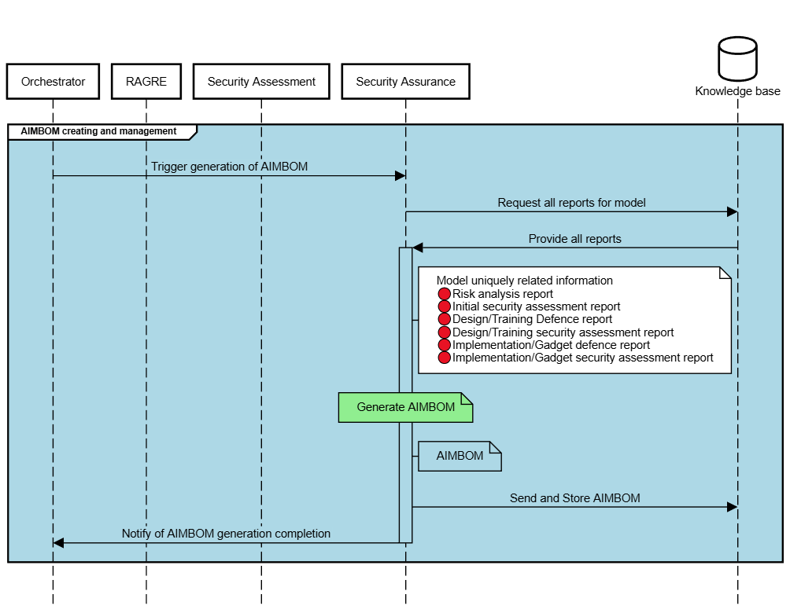

# STR Assurance Engine - Architecture

## Architecture

## AIMBOM Generation

The AIMBOM generation process is responsible for transforming validated reports into structured AIMBOMs. When a request is made for a specific AI model, STRAE retrieves all relevant reports from the Report Pool and passes them through a report validation stage, where their format, integrity, and completeness are checked. Finally, the engine consolidates these reports, using the AIMBOM Generator, to create the final security report. This process aligns the collected data with trustworthiness, fairness and ethical guidelines (as defined in T1.5 and D1.4 respectively) and ensures that security, robustness, and context-awareness findings are fully represented. The finalized AIMBOM is stored in the Security Assurance Pool and made available to the CoEvolution Hub. This ensures that every assessed AI model is accompanied by a transparent, standardized, and trustworthy record of its development, evaluation, and assurance processes.

### AIMBOM Generation Flow

## API Endpoints

| Endpoint | Method | Description | Input | Output |
|----------|--------|-------------|-------|--------|
| `/api/status` | GET | Health check endpoint for the STRAE API | - | Health Status & Version information |
| `/api/sign` | POST | Sign the given report | Report payload (JSON format) | Signed report |
| `/api/generate` | POST | Generate an AIMBOM for the given model UUID and version by aggregating reports from MinIO | model_uuid, model_version, reports_metadata | Confirmation Message & Unique AIMBOM identifier |

## Kafka worker

The Kafka worker is responsible for enabling asynchronous AIMBOM generation within the STR Assurance Engine. It decouples request submission from processing by consuming generation tasks from a Kafka topic and executing them independently of the API layer.

The worker subscribes to a configured Kafka topic and listens for messages containing AIMBOM generation requests. Each message includes a target model identifier, version, and associated report references. Upon receiving a valid event, the worker retrieves the required data through the Orchestrator API, triggers the AIMBOM generation pipeline, and persists the resulting AIMBOM to the Security Assurance Pool.

If processing succeeds, the Kafka offset is committed. In case of recoverable errors (such as missing reports or transient storage issues), the worker may delay or skip committing offsets to allow for retries, depending on the failure type. Invalid or malformed messages are safely discarded to prevent blocking the queue.

The worker is designed to run as a long-lived background service and does not expose any HTTP endpoints.

### Kafka Worker Processing Flow
- Consume message from Kafka topic
- Validate payload (model_uuid, version, reports)
- Retrieve required reports via Orchestrator API
- Execute AIMBOM generation
- Store generated AIMBOM in the Security Assurance Pool
- Commit Kafka offset on success or controlled failure

## Technological Tools

(Update this section)